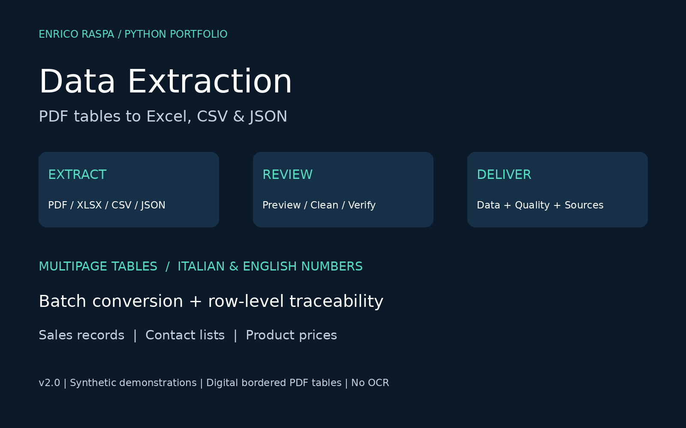

# Data Extraction v2.0
**Extract, review and convert tabular files.** Portfolio project by Enrico Raspa.



Local Python application built with pandas, pdfplumber and Streamlit.
[Guida in italiano](LEGGIMI_ITALIANO.txt) · [Validation](VALIDATION.md) · [MIT license](LICENSE)

## What it does
- Extracts bordered tables from digital PDFs; reads XLSX, CSV and flat JSON.
- Shows the PDF page beside extracted data for visual review.
- Merges explicitly selected tables with matching headers and removes repeated header rows.
- Offers optional trimming, duplicate removal, empty-row removal and output column selection.
- Converts selected numeric columns using Italian or English notation, including currency symbols,
  negatives and percentages. Invalid entries remain text and are reported; identifiers stay intact.
- Exports XLSX, CSV or JSON. Excel includes Data, Quality, Columns, Audit,
  Provenance and Conversion issues. Provenance links each output row to a file and source table row.
- Processes multiple files into a ZIP with a manifest of successes and failures. Batch mode exports
  each source table separately and preserves numeric text for later individual review.
- Provides descriptive statistics and a frequency chart, without business interpretation.

## Start on Windows
Install Python 3.10+ (enable Add Python to PATH), extract this entire folder,
then double-click `start_windows.bat`. First installation requires internet.
Keep the terminal open while using the local browser app.

## macOS / Linux / manual launch
From this folder:
```
python -m venv .venv
source .venv/bin/activate
python -m pip install -r requirements.txt
python -m streamlit run app.py
```
On Windows use `.venv\Scripts\activate` instead of `source`.
Local application; no API key is required. Do not expose as a public service
without additional security and resource controls.

## Portfolio demonstrations
1. Sales register: enable duplicate removal; 7 rows become 6, EUR 2,850 total.
2. Contacts: 4 rows become 3 after duplicate removal; missing email is flagged.
3. Product list: select Price EUR and Discount for Italian numeric conversion.
   Prices total EUR 1,576.40. A 12.5% discount becomes the fraction 0.125.
4. Additional multipage example: upload `examples/sales_multipage.pdf`, enable merge,
   select both tables and convert Amount EUR. Four rows, total EUR 2,750.50.
For each demonstration `*_reviewed.xlsx` and `*_audit.json` are included.
All examples are synthetic. `portfolio/UPWORK_EN.txt` contains publication copy.

## Numeric sorting
Imported Excel and CSV values are initially preserved as text. To sort a value column
numerically (1, 2, 9, 10 rather than 1, 10, 2, 9), select it under **Convert these columns
to numbers**, choose the matching numeric format, then sort the reviewed results table.
Leave codes and identifiers unselected to preserve leading zeros. Sorting by clicking a
table header changes the on-screen view only; exported rows retain processing order.

## Conversion rules and limits
- Digital bordered PDF tables only. No OCR, photos, arbitrary layouts, merged-cell
  reconstruction or guaranteed accuracy. Verify every extracted result against the source.
- Matching headers do not establish semantic equivalence: merging is a user decision.
  With PDF headers enabled, each table's first row is interpreted as a header;
  do not enable this for continuation tables lacking a header.
- XLSX only, no legacy XLS. Formula results use cached values; no recalculation.
  Original formatting, charts and leading zeros encoded only in number formats are not preserved.
- CSV separator and encoding are explicit. JSON accepts flat arrays of record objects only.
- Numeric conversion is opt-in by column. Italian uses comma decimals/dot thousands;
  English uses dot decimals/comma thousands. No automatic date parsing or locale guessing.
  Supported currency markers: EUR, USD, euro and dollar symbols at the ends.
  Values outside +/-1e15 are rejected; floating-point exports can have rounding limits.
  Percentages become fractions. Invalid numeric strings are retained, never silently discarded.
- Duplicate removal uses all columns after numeric conversion and before output column selection.
- Source row numbers refer to rows in the extracted table, not physical PDF line numbers.
  Traceability identifies the retained row if duplicate removal discards subsequent copies.
- Per-file limit 25 MB, 100 PDF pages; batch limit 20 files / 100 MB total.
  Uses memory; intended for small/medium tabular files, not unrestricted workloads.
- Batch numeric normalization is intentionally excluded; use single-file column review.
  Batch failures appear in the manifest; successful files remain available.
- XLSX stores strings literally. Raw CSV can be interpreted by spreadsheets as formulas;
  import text columns explicitly or use XLSX for such content.

## Structure and tests
`data_extraction/core.py`: import, merge, prepare, numeric parsing, profiling,
export, row provenance, batch ZIP and PDF page rendering.
`app.py`: local Streamlit UI. `tests/`: regression and interface tests.
`examples/`: synthetic input/output pairs. `portfolio/`: cover and English copy.
Install `requirements-dev.txt` for test-only dependencies.
Run: `python -m unittest discover -s tests -v`.
See VALIDATION.md for executed checks and limitations. MIT license.
